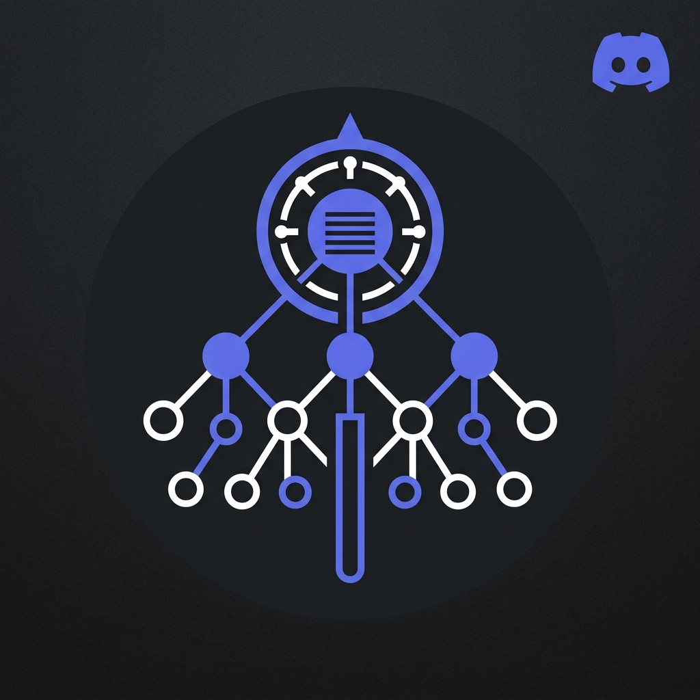

<p align="center">
  
</p>

<h1 align="center">MapMyServer</h1>

<p align="center">
  <strong>Standalone Discord Server Architecture Intelligence, Security Auditing & Recreation Platform</strong><br/>
  An open-source Chrome extension that inspects, analyzes, compares, optimizes, and recreates Discord server architectures.
</p>

<p align="center">
  
  
  
  
  
  
  
</p>

---

## 🌟 What Is MapMyServer?

**MapMyServer** is a standalone, client-side Chrome browser extension that turns Discord servers into analyzable, reproducible architectural blueprints. Whether you are a community founder, administrator, moderator, or Discord bot developer, MapMyServer eliminates manual guesswork by providing deep visibility into server taxonomies, role hierarchies, and permission configurations.

### The Central Workflow
```
DISCOVER ──▶ SCAN ──▶ ANALYZE ──▶ UNDERSTAND ──▶ CUSTOMIZE ──▶ COMPARE ──▶ RECREATE
```

MapMyServer operates **100% offline and client-side**:
- **Zero Telemetry**: No tracking pixels, analytics cookies, or external surveillance.
- **No Mandatory Backend**: Operates standalone in Chrome using `chrome.storage.local`.
- **Bring Your Own Key (BYOK)**: Connect your own preferred AI model directly without monthly SaaS subscriptions.

---

## 🚀 Key Capabilities

### 1. Non-Intrusive Discord Architecture Scanner
- **Virtual Scroller Sweep**: Automatically scans virtualized Discord sidebars to discover channels in servers with 50+ categories and hundreds of channels.
- **Real-Time Tab Synchronization**: Seamlessly updates when you switch Discord servers or edit channels.
- **Rich Channel Classification**: Categorizes channels into 12 purpose taxonomies (Onboarding, Announcements, Discussions, Governance, Support, etc.).
- **Live Channel Metadata**: Extracts topics, slowmode limits, and instructions where accessible.

### 2. Dual Architecture Capture Modes
- **Mode A: Full Administrator Capture (Server Owner / Admin)**  
  Captures complete server taxonomy, categories, channels, role hierarchy, color ordering, bitfield permission flags, and channel-level permission overwrites.
- **Mode B: Accessible Architecture Capture (Regular Server Member)**  
  Strictly respects Discord user access boundaries. Gathers only visibly accessible categories and channels. Never bypasses permissions or scrapes private channels, and automatically attaches a transparent partial-capture disclosure notice.

### 3. Permission Intelligence Engine
- Full Discord bitfield calculation (`VIEW_CHANNEL`, `SEND_MESSAGES`, `MANAGE_CHANNELS`, etc.).
- Resolves `@everyone` base permissions, role combinations, member overwrites, and `ADMINISTRATOR` bypass flags.
- Validates category permission inheritance and synchronization status.
- 5-tier channel accessibility classification (`broadly-accessible`, `role-restricted`, `member-restricted`, `inaccessible`, `unknown`).

### 4. Security Audit Center & Server Health Score
- **100-Point Security Health Score**: Deterministic health score evaluating server organization, permission posture, and administrative hygiene.
- **Severity-Tiered Audit Findings**: Flags public `@everyone` mentions, administrative role sprawl, unlinked categories, and excessive channel overwrites.
- **Remediation Guides**: Actionable step-by-step guidance to remediate vulnerabilities before they are exploited.

### 5. AI Server Architect (Multi-Provider BYOK)
- Direct Bring Your Own Key integration with:
  - **OpenAI**: GPT-4o, GPT-4o-mini
  - **Anthropic**: Claude 3.5 Sonnet, Claude 3.5 Haiku
  - **Google Gemini**: Gemini 2.0 Flash, Gemini 1.5 Pro
  - **OpenRouter**: Access to hundreds of open-source models
  - **Custom / Local**: Self-hosted Ollama (`http://localhost:11434`) and OpenAI-compatible endpoints
- **What-If Architecture Sandbox**: Propose structural changes and visualize additions, modifications, and removals before executing.
- **Documentation Generator**: Auto-generates Markdown, HTML, JSON, and CSV guides for developers, moderators, or onboarding members.
- **Prompt Injection Defense**: Security enclosure boundaries sanitize server text to prevent prompt injection attacks.

### 6. Smart Server Cloner & Automation Recreation
- **8-Step Guided Workflow**: Source Selection ➔ Capture Review ➔ Component Selection ➔ AI Customization ➔ Destination Strategy ➔ Destructive Review ➔ Code Generation.
- **Selective Component Cloning**: Clone the entire server, selected categories, or granular channels with on-the-fly renaming and topic toggles.
- **Selective Merge Strategy**: Merges into existing destination servers while automatically skipping duplicate channels without overwriting.
- **Ready-to-Run Automation Scripts**:
  - `discord.js` v14 script with `--dry-run` flag, idempotency, and rate-limit handling.
  - `discord.py` v2 script with async concurrency.
  - Reusable JSON Template and step-by-step manual Markdown checklist.
  - All scripts safely read credentials via `process.env.DISCORD_BOT_TOKEN`.

### 7. Curated Templates & Version History
- **9 Production Templates**: Pre-configured blueprints for Developer Communities, Open Source Projects, Gaming Guilds, Creator Spaces, Tech Startups, and Education.
- **Architecture Snapshots**: Capture manual and automatic point-in-time snapshots to track changes over time.
- **Side-by-Side Comparison**: Visually diff two servers or snapshots to identify missing, added, or modified channels.

### 8. Local Backup, Restore & Offline Privacy
- **Zero-Trace Wipe**: Permanently purge all stored server blueprints from local browser storage in one click.
- **Complete JSON Backup**: Export and restore all saved servers, snapshots, and custom templates with schema validation.

---

## 📦 Installation & Getting Started

You do **not** need to install Node.js or run terminal commands to use the pre-built extension.

### Step 1: Open Chrome Extensions
1. In Google Chrome, navigate to `chrome://extensions/`.
2. In the top-right corner, toggle **Developer mode** to **ON**.

### Step 2: Load Unpacked Extension
1. Click the **Load unpacked** button in the top-left corner.
2. Select the **`extension/dist`** folder inside the MapMyServer repository:
   ```
   MapMyServer/
   └── extension/
       └── dist   <-- SELECT THIS DIRECTORY
   ```

### Step 3: Open Discord and Start Analyzing
1. Open Discord in your browser: [https://discord.com/channels/@me](https://discord.com/channels/@me).
2. Click the puzzle icon 🧩 in Chrome's toolbar and pin **MapMyServer**.
3. Open the Chrome Side Panel (or click the MapMyServer toolbar icon).
4. Navigate to any Discord server and click **Analyze Current Server**!

> 💡 *Want a quick test drive without opening Discord?* Click **Load Rich Mock Community** on the welcome screen to explore all tree, graph, audit, and cloning tools with GDG Community sample data.

---

## 🔑 AI Provider Configuration (BYOK)

To enable AI features:
1. Open the MapMyServer side panel.
2. Click the **⚙️ Settings icon** in the top header.
3. Click **Configure AI Providers & Keys**.
4. Select your preferred provider (OpenAI, Anthropic, Gemini, OpenRouter, or Custom Ollama).
5. Paste your API key and click **Test Connection** to verify.
6. Click **Save Configuration**.

Your API keys are stored strictly in `chrome.storage.local` on your computer and are never transmitted to MapMyServer maintainers or any third party.

---

## 🛠️ Recreating a Server via Bot Scripts

When recreating a server structure using the generated automation scripts:

1. Create a Discord Bot application in the [Discord Developer Portal](https://discord.com/developers/applications).
2. Invite your bot to your target server with **Administrator** or **Manage Channels & Manage Roles** permissions.
3. Set your bot token in your environment:
   ```bash
   # Linux / macOS
   export DISCORD_BOT_TOKEN="your_bot_token_here"

   # Windows PowerShell
   $env:DISCORD_BOT_TOKEN="your_bot_token_here"
   ```
4. Run the script:
   ```bash
   # Dry-run test (simulates without creating channels)
   node recreate_server.js --guild YOUR_GUILD_ID --dry-run

   # Real execution
   node recreate_server.js --guild YOUR_GUILD_ID
   ```

---

## 🔒 Security & Privacy Notice

MapMyServer strictly respects Discord's Terms of Service and user security:
- **No Self-Bots**: MapMyServer does not use user tokens or self-bot automation.
- **Respects Permissions**: Restricted channels that your account cannot see are never scraped or accessed.
- **Client-Side Only**: All data remains on your machine.
- For complete details, see [SECURITY.md](SECURITY.md).

---

## 💻 Monorepo Development & Testing

```bash
# Clone the repository
git clone https://github.com/SudiptaSanki/MapMyServer.git
cd MapMyServer

# Install dependencies
npm install

# Run all 63 unit and integration tests
npm test

# Build all packages (shared, extension, backend)
npm run build
```

---

## 📄 License

MapMyServer is open-source software licensed under the [MIT License](LICENSE).

<!-- autobot:start -->
<!-- s:32c3b0d1 t:2026-11-09T09:55:27.301Z a:resolved conflicts b:8214 -->
<!-- autobot:end -->
